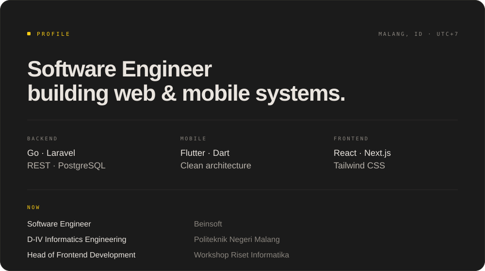

### Hi, I'm Wandi

I build production systems end to end — Go and Laravel backends, Flutter apps, React front ends. 
Based in Malang, Indonesia · open to remote and hybrid roles.

---

## About

  

## Stack

## Selected work

<b>Sikamo</b> &nbsp;·&nbsp; SaaS POS platform for SMEs &nbsp;·&nbsp; <a href="https://sikamo.wandidev.my.id">live ↗</a>

 

Point-of-sale built for small shops: dynamic QRIS payments, WhatsApp receipts, multi-outlet inventory, and a Filament admin panel.

`Laravel` `Reverb` `Filament` `Fonnte` `MySQL`

<b>JDHub</b> &nbsp;·&nbsp; Document management centre &nbsp;·&nbsp; <a href="https://jdhub.wandidev.my.id">live ↗</a>

 

Central document repository with AI-assisted metadata extraction, so staff stop filing the same paperwork twice.

`Laravel 12` `Alpine.js` `Tailwind v4` `Vite` `Gemini AI`

<b>HealthMind AI</b> &nbsp;·&nbsp; Mental-health companion &nbsp;·&nbsp; <a href="https://github.com/wandi1209/health-mind">source ↗</a>

 

Mobile app with an AI companion, offline-first storage, and a clean-architecture Flutter codebase split into features and layers.

`Flutter` `Supabase` `Gemini AI` `ML Kit` `BLoC`

<b>Expense Tracker</b> &nbsp;·&nbsp; Pocket-based finance tracker &nbsp;·&nbsp; <a href="https://github.com/wandi1209/expense_tracker_app/releases/latest">release ↗</a>

 

Personal finance app that reads receipt totals from the camera and ships signed builds through GitHub Actions.

`Flutter` `Firebase` `Firestore` `ML Kit` `GitHub Actions`

<b>Edusam</b> &nbsp;·&nbsp; Learn from YouTube videos with AI

 

Turns long videos into structured lessons: transcript-aware summaries, chapters, and quizzes generated on demand.

`Next.js` `TypeScript` `Tailwind v4` `Supabase` `Gemini AI` `YouTube Data API`

## GitHub

 

<!--
  Optional: the contribution snake. It needs a workflow in this profile repo
  (.github/workflows/snake.yml) that renders the SVG on a schedule. Until that
  exists, the image below would 404 — so it stays commented out.

  

    
  

-->

## Highlights

- 18+ projects delivered, from internal hospital systems to SaaS products in production
- Mentored 20+ students at Workshop Riset Informatika; now leading its Frontend division
- Systems serving 500+ concurrent users
- Comfortable owning a feature end to end: schema → API → UI → deployment

---

**Got a system that needs building?** 
[wandider@gmail.com](mailto:wandider@gmail.com) · [LinkedIn](https://www.linkedin.com/in/wandidev) · [Instagram](https://instagram.com/wnd_130)

<i>Last updated: October 2026</i>

